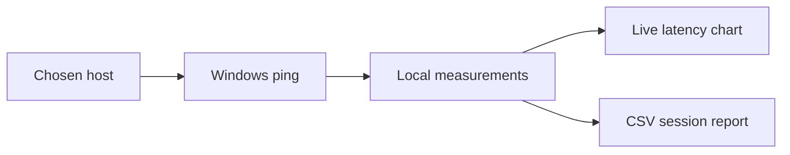

# PingScope

**Local network-quality monitor for Windows.** Measure response time, latency variation (jitter), and packet loss for a game server, router, or any host you choose. Watch a live chart, then save the session as CSV.

PingScope uses the Windows `ping` utility and Python's standard library. It does not change network settings, require administrator access, install a driver, or upload measurements.

## Run

### Ready-to-run build

Download `PingScope-v0.2.3-windows-x64.zip` from [Releases](https://github.com/GhosTnever-lkm/ping-scope/releases/latest), extract it, and double-click `PingScope.exe`. Python does not need to be installed. The first launch can take a few seconds while Windows starts the bundled files.

### Run from source

1. Install Python 3.10 or newer from [python.org](https://www.python.org/downloads/windows/) and enable the Python launcher or **Add Python to PATH**.
2. Download this repository and extract it.
3. Double-click `run.bat` (or run `py -3 ping_scope.py`; if the launcher is unavailable, use `python ping_scope.py`).

No packages need to be installed. Windows Firewall or the target host may block ICMP echo requests; in that case the application records packet loss, which does not necessarily mean the game server itself is unreachable.

## Read the measurements

- **Average latency** is the arithmetic mean of received echo replies.
- **Jitter** is the mean absolute change between consecutive received replies. It is a simple session indicator, not a substitute for a protocol-specific voice or game jitter metric.
- **Packet loss** is the fraction of unanswered ICMP probes in this session.
- **Chart** shows up to the latest 200 probes. A cross marks a probe with no recognized reply.
- **CSV export** includes each probe's local timestamp and outcome plus a compact session summary.

Use a host relevant to your route. A public DNS address is only a convenient connectivity example, not a proxy for any particular game's server.

## Limitations

PingScope measures ICMP round-trip time from this computer. It cannot measure game-server tick delay, congestion inside the game, FPS, or guarantee that another protocol follows the same route. Results are most useful when comparing repeated sessions from the same location and connection.

## Development

```powershell
py ping_scope.py
python -m unittest discover -s tests -v
```

The interface and measurements are local. CSV export happens only when you explicitly choose a destination.

## License

MIT. See [LICENSE](LICENSE).

## Flow



## ☕ Support / Pro Version

PingScope is currently free and open source under MIT; there is no separate Pro build or paid feature set. If you find it useful, support the developer on [Boosty](https://boosty.to/azizazimov) or [Buy Me a Coffee](https://buymeacoffee.com/azizazimov8). Support does not unlock additional functionality.
